# Architecture

```mermaid
flowchart LR
    A[Founder brief] --> B[Five ranked assumptions]
    B --> C[Curated demo evidence or bounded web search]
    C --> D[Evidence IDs and assumption links]
    D --> E[Highest-priority open assumption]
    E --> F[Experiment with a decision threshold]
    F --> G[Streamlit workspace]
    G --> J[Founder review and observed outcome]
    J --> H[(Local SQLite history)]
    H --> I[HTML memo and Markdown export]
```

## Application boundaries

| Layer | Responsibility |
| --- | --- |
| `app.py` | Collect the idea brief and research consent. Render assumptions, evidence passages, the next experiment, and the recorded research trace in Streamlit. |
| `idea_diligence/engine.py` | Generate or load five assumptions, rank them, retrieve and link evidence, and produce an experiment for one unresolved assumption. Keep structured results available to the same UI in both modes. |
| `idea_diligence/providers.py` | Call a configurable OpenAI-compatible model to propose assumptions and reason over evidence. Use Tavily for live search. |
| `idea_diligence/storage.py`, `decision.py` and `report.py` | Store analysis snapshots, latest founder evidence reviews, and the recorded experiment outcome in SQLite. Derive reviewed direction from accepted links and export printable HTML or Markdown. |

The brief captures the audience, problem, proposed product, and what the founder already knows. The first live model call proposes assumptions and derives focused queries. The second maps retrieved passages to assumptions and proposes an experiment. Demo mode starts from the fixed audio-briefing brief and exercises the ranking and evidence checks over `fixtures/catch_me_up.json`. The mode and activity trace give a reviewer the context needed to interpret the result.

## Per-run budget

Live research defaults to GPT-5.4 mini and Tavily basic search. The engine allows up to two model calls, five search calls, three returned results per search, and ten unique source excerpts. Each model request is limited to 32 KiB and each completion to 2,500 tokens including reasoning. The client deadline is 75 seconds across the run. The trace records attempted calls and any token usage reported by the provider. Actual charges depend on provider pricing and usage. [Model reference](https://developers.openai.com/api/docs/models/gpt-5.4-mini) · [Search API reference](https://docs.tavily.com/documentation/api-reference/endpoint/search)

## Evidence contract

The application assigns IDs to retrieved evidence and rejects invalid references. An assumption link points to a known ID and records the relation and reasoning. Displayed source text comes from the evidence record. Live page excerpts are matched against the cleaned page text supplied by the search provider. Search snippets supply context. Whether the passage warrants the inference remains a human review question.

A product page that documents built-in audio generation may challenge a claim of product differentiation. It offers no direct measurement of a proposed audience’s listening habits. In live mode, apparent support for desirability and viability is treated as context. All assumptions preserve their assigned initial risk. After checking the evidence links, Python selects the highest-ranked open, context-only, or mixed assumption. If every assumption has directional evidence on one side, it selects the highest-ranked assumption overall. The model proposes an experiment using this same rule. A proposal that fails the required checks, including the selected target, leaves the run partial and the experiment empty.

## Engineering decisions

- **One local web app.** Streamlit lets the project demonstrate the full user workflow with Python and a small UI. SQLite supports reproducible, single-user history without a hosted database.
- **Bounded research.** Show the actual calls in the trace. The run limits constrain work even when evidence is scarce. Product coverage varies with source availability, search quality, and which pages can be inspected.
- **Inspectable recommendation.** Connect the experiment to the assumption ID. Specify what to measure, a threshold, and how the outcome changes the founder’s decision. Treat the threshold as a proposed decision rule.
- **Opt-in external calls.** API credentials come from local environment variables. Live mode sends information about the brief to configured providers. Curated demo mode runs without those calls.
- **Reproducible recording.** The frozen public case gives reviewers the same passages as the recording and lets them check the code and interpretation on their own.
